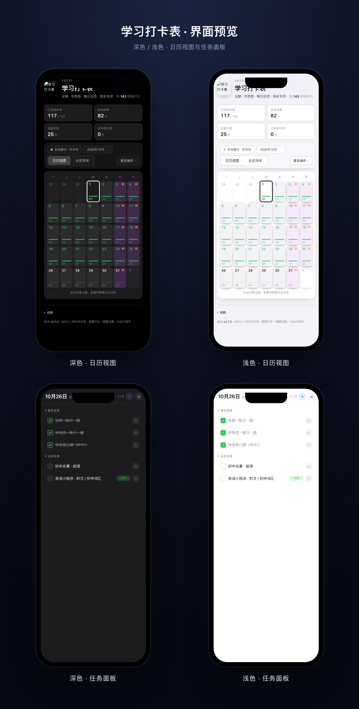

# 学习打卡表

学习打卡应用（网页版）。当前版本：**v2.7.5**

## 预览

  

> 预览为 2×2 排列：上排深色 / 浅色日历视图，下排深色 / 浅色任务面板。

## 目录

- `checkin-app/` — 云端同步版（已发布，支持打卡码跨设备云同步、月份切换、自定义条目与附件）
- `学习打卡表.html` — 离线单文件版（本地直接打开使用，隐藏云 UI）

## 功能

- 按课表自动生成每月打卡任务（每日作业、课程、周末专项、公式活页本等）
- 月份切换（2026年10月 – 2027年6月，共 9 个月），选项（自定义、改名、删除、附件）跨月自动同步
- 打卡码跨设备云同步（勾选进度原子合并，多设备防冲突）
- 自定义条目：添加 / 改名 / 改时间 / 删除（每日类条目整类生效）
- 附件上传：图片压缩后内联显示，其他文件可下载
- 应用内提醒设置（支持多条独立提醒、自定义提醒文案、提醒日可选周一至周日）
- 深色模式：「跟随系统深浅模式」默认开启，随手机 / 电脑系统自动切换深 / 浅色；可在「提醒设置」中关闭（关闭则始终浅色）

## 版本记录

| 版本 | 日期 | 更新 |
| --- | --- | --- |
| v2.7.5 | 2026-11-04 | 修复：抽屉里点「＋添加条目」弹窗被抽屉盖住需先关抽屉；Esc 改为逐层退出；「删除此条目 / 关闭」改为清晰描边按钮（删除为红色），保存独占一行 |
| v2.7.4 | 2026-11-04 | 自检修复：① 定时提醒轮询失效（仅开每日规则时不启动）② 深浅模式默认文案与行为不一致 ③ 提醒按"今天"而非选中日 ④ 图片预览时 Esc 误关日期面板 ⑤ 完成特效标题按实际日期；清理重复代码 |
| v2.7.2 | 2026-11-03 | 修复：点击跨月溢出格只切换日历视图、不弹任务；新增左划屏幕右边缘退出抽屉手势 |
| v2.7.1 | 2026-11-03 | 原创「对勾花瓣」Logo 落地（替换皮卡丘），favicon 与应用图标同步换新 |
| v2.7.0 | 2026-11-03 | UI 打磨：面板隐藏为滑入抽屉；工具栏次级操作折叠；修复深色定位按钮白块；质感与动效提升 |
| v2.6.0 | 2026-11-02 | 全平台统一 iPhone（iOS）观感，停用 macOS 窗口 / 侧栏差异化布局 |
| v2.5.1 | 2026-11-02 | 修复 macOS 窄窗日历溢出盖住清单（加响应式断点） |
| v2.5.0（回档） | 2026-11-02 | 撤销 v3.x 全部改动，仅保留页脚说明折叠 |

更早版本（v2.4.6 及以前，点击展开）

| 版本 | 日期 | 更新 |
| --- | --- | --- |
| v2.5.0 | 2026-11-01 | Apple 设计系统重构：设备分流、系统色、窗口外壳与侧栏、sheet 弹窗 |
| v2.4.6 | 2026-11-01 | 修复提醒面板视觉；提醒默认全关；绑定弹窗新增打卡码复制 |
| v2.4.5 | 2026-10-31 | 公式活页本固定星期；日历溢出格可点击切月 |
| v2.3.5 | 2026-10-30 | 修复清单视图深色模式标题条看不清 |
| v2.3.4 | 2026-10-30 | 浅色格子改暖灰防刺眼；补全深色残留白；跟随系统深浅默认开 |
| v2.3.3 | 2026-10-30 | 修复深色模式输入框聚焦闪白；缩略图 / 预览改深色；分段控件选中态 |
| v2.3.2 | 2026-10-30 | 新增跟随系统深浅模式；CSS 全变量化 + 完整暗色主题 |
| v2.2.2 | 2026-10-29 | 学而思口算周末隐藏；多条独立提醒 + 自定义文案；SDK 本地同源加载 |
| v2.2.1 | 2026-10-29 | 每日一题仅工作日；提醒日可自定义（周一至周日） |
| v2.2.0 | 2026-10-28 | 日历角标、图片预览、考试提醒、当日完成特效、默认日历视图 |
| v2.2 | 2026-10-28 | 月份扩展至 2027-06；10 月预勾选；修复 iOS 图标 |
| v2.1 | 2026-10-28 | 更名「学习打卡表」；月份切换；选项跨月同步 |
| v2.0 | 2026-10-28 | 自定义 / 修改 / 删除条目；附件上传；自定义图标 |
| v1.0 | 2026-10-28 | 版本号体系；应用内提醒设置 |
| v1.0 前 | 2026-10-27~28 | 初版、手机适配、打卡码云同步、课表规则、原子合并、星火跳转 |

